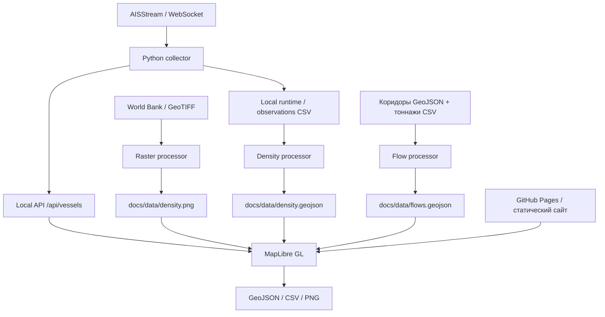

# Архитектура

## Контракты данных

| Слой | Формат | Поля | Единица |
|---|---|---|---|
| `density.geojson` | FeatureCollection / Polygon | `ship_hours`, `positions`, `vessels` | Судно-часы, сообщения, MMSI |
| `density.png` | RGBA PNG 3857 | Метаданные `density_meta.json` | Цветовая нормализация исходного GeoTIFF |
| `flows.geojson` | FeatureCollection / LineString и MultiLineString | `route_id`, `year`, `cargo_tonnes`, `status`, `source_url`, `method` | Тонны в год |
| `vessels.geojson` | FeatureCollection / Point | `mmsi`, `name`, `speed_knots`, `course_degrees`, `timestamp_utc` | Узлы, градусы, время UTC |

### Договорённости о достоверности

1. `tonnage_unverified`: географический коридор существует как иллюстрация, вес не известен.
2. `estimated_or_observed`: указаны тоннаж, источник, метод и год; проверка точности остаётся ответственностью аналитика.
3. `geometry_method=schematic_waypoints`: последовательность опорных точек без гарантии совпадения с проходами реальных судов.
4. `ship_hours`: внутри ячейки учитывается одна пара MMSI + календарный час UTC, даже если за этот час судно передало много сообщений.
5. `vessels`: последняя позиция из текущей сессии приёмника, без гарантии глобального покрытия.
6. GeoJSON использует координаты `[долгота, широта]` (EPSG:4326), AISStream для фильтра требует `[широта, долгота]`.

## Статический и локальный режимы

- **GitHub Pages:** только опубликованные файлы `docs/`, включая экспортированные данные. История и живой AIS не обновляются самостоятельно.
- **MacBook:** `maritime-atlas serve` запускает FastAPI и тот же интерфейс; `maritime-atlas track` обновляет локальный файл, а `/api/vessels` отдаёт его браузеру.
- **Jupyter:** скачивает версии данных с GitHub Raw и отображает опубликованную карту. Python-пакет может быть установлен прямо из вашего публичного GitHub-репозитория.

## Что потребуется для дальнейшего уровня

- Аутентифицированный отдельный сервер или фоновой сборщик с историческим хранением AIS.
- Проверенные ODM (origin-destination matrices) грузов с соответствием рейс/масса/период.
- Морской граф и сопоставление фактических AIS-треков с сегментами сети.
- При глобальных AIS-массивах - Parquet/GeoParquet, пространственная БД и растровые/vector tiles вместо больших GeoJSON.
